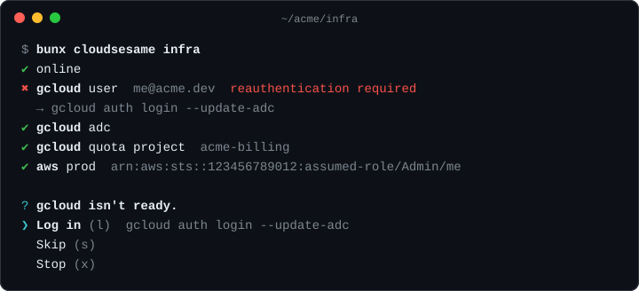

<p align="center">
  
</p>

<h1 align="center">cloudsesame</h1>

<p align="center">
  <b>Open sesame for your clouds.</b><br>
  Checks that you're online and logged in to <b>gcloud</b>, <b>aws</b> and <b>az</b> before you work, and logs you in when you're not.
</p>

<p align="center">
  <a href="https://www.npmjs.com/package/cloudsesame"></a>
  <a href="https://github.com/NexiHealth/cloudsesame/releases/latest"></a>
  <a href="https://github.com/NexiHealth/cloudsesame/actions/workflows/ci.yml"></a>
  <a href="LICENSE"></a>
</p>

<p align="center">
  <a href="https://nexihealth.github.io/cloudsesame/">Docs</a> ·
  <a href="#install">Install</a> ·
  <a href="#configure">Configure</a> ·
  <a href="#use-it-in-your-scripts">Scripts</a> ·
  <a href="#ci-and-ai-agents">CI &amp; agents</a>
</p>

<p align="center">
  
</p>

## Why

You run `bun dev` or `tofu plan`. Halfway through, it dies with `invalid_grant`, `ExpiredToken` or `AADSTS700082`. You look up the right login command, log in, and run it again.

cloudsesame checks everything in a few seconds before you start:

- 🌐 **Connectivity.** It knows you're offline before it tries to log you in.
- 🔑 **Logins.** gcloud (user and Application Default Credentials), AWS (SSO and console login), and Azure.
- 🎯 **The right account.** Expected gcloud account, project and quota project, AWS account ID, Azure tenant and subscription.
- 🚪 **One-key fixes.** It runs the exact login for you (`aws sso login --profile prod`), then checks again.
- 🤖 **CI and AI agents.** No prompts without a terminal: clear exit codes, the command to run, and `--json`.

## Install

| | |
| --- | --- |
| **npm / Bun** | `bunx cloudsesame` · `npx cloudsesame` · `npm i -g cloudsesame` |
| **Homebrew** (macOS, Linux) | `brew install NexiHealth/tap/cloudsesame` |
| **Scoop** (Windows) | `scoop bucket add NexiHealth https://github.com/NexiHealth/scoop-bucket`<br>`scoop install cloudsesame` |
| **Chocolatey** (Windows) | `choco install cloudsesame` |
| **Binary** | Download from the [latest release](https://github.com/NexiHealth/cloudsesame/releases/latest) and put it on your `PATH` |

<!-- winget is disabled for now (skip_upload in .goreleaser.yaml). Add back once published:
| **winget** (Windows) | `winget install NexiHealth.cloudsesame` |
-->

The npm package runs on Node ≥ 18 or Bun. The interactive UI needs Node ≥ 22; older versions get plain output.

## Quick start

```sh
cloudsesame init     # write sesame.config.ts from the CLIs you have installed
cloudsesame          # check, and offer to log in where needed
```

No config? cloudsesame checks every cloud CLI you have installed, with default settings.

| Command | What it does |
| --- | --- |
| `cloudsesame` | **auth** (default): checks each provider and offers to **Log in**, **Skip** or **Stop**. Fails offline |
| `cloudsesame predev` | Connectivity first, then auth. You can continue offline or skip a provider, and `dev` still starts |
| `cloudsesame check` | Report only. Never prompts. Exit 4 if anything isn't ready |
| `cloudsesame init` | Generate `sesame.config.ts` (or `--json` for `sesame.config.json`) |
| `cloudsesame aws` · `cloudsesame infra` | Only check some providers, or a [group](#groups) from your config |

## Configure

Put `sesame.config.ts` (or `.mts`, `.js`, `.mjs`, `.json`) in your repo. cloudsesame finds the nearest one, from the current directory up to the git root. The config holds no secrets, so commit it.

```ts
// sesame.config.ts
import type { Config } from "cloudsesame";

export default {
  gcloud: { credentials: "adc", project: "acme-dev" },
  aws: { profile: "dev" },
} satisfies Config;
```

The `import type` is erased at runtime, so the project doesn't need cloudsesame installed. Add it as a dev dependency if you want autocompletion. TypeScript configs load in Bun, the binaries and Node 22.18+. On older Node, use JSON with the schema:

```json
{
  "$schema": "https://unpkg.com/cloudsesame/dist/schema.json",
  "gcloud": { "credentials": "adc", "project": "acme-dev" },
  "aws": { "profile": "dev" }
}
```

### Examples

<details open>
<summary><b>Web app on Google Cloud</b>: SDKs use Application Default Credentials</summary>

```ts
export default {
  gcloud: { credentials: "adc", project: "acme-dev" },
} satisfies Config;
```

`credentials` is `"adc"` for code that uses Google SDKs or OpenTofu/Terraform, `"user"` for scripts that call the `gcloud` CLI, and `"both"` (the default) when you're not sure.

</details>

<details>
<summary><b>Infra repo</b>: OpenTofu on GCP and AWS, with the right accounts</summary>

```ts
export default {
  gcloud: {
    credentials: "both",
    account: "me@acme.dev",
    project: "acme-prod",
    quotaProject: "acme-billing", // project billed when SDKs call Google APIs as you
  },
  aws: [
    { profile: "staging", accountId: "111111111111" },
    { profile: "prod", accountId: "222222222222" },
  ],
  groups: { infra: ["gcloud", "aws"] },
} satisfies Config;
```

`cloudsesame infra` checks both clouds. A login to the wrong account or project counts as not ready, and cloudsesame offers the command that fixes it.

</details>

<details>
<summary><b>Azure</b>: pin the tenant and subscription</summary>

```ts
export default {
  az: { tenant: "00000000-0000-0000-0000-000000000000", subscription: "Contoso Dev" }, // subscription: ID or name
} satisfies Config;
```

</details>

<details>
<summary><b>Never block anyone</b>: warn and continue</summary>

```ts
export default {
  gcloud: { credentials: "adc" },
  offline: "continue", // predev: don't ask when offline
  unauthenticated: "skip", // warn about missing logins, never prompt
  animation: "never",
} satisfies Config;
```

</details>

### Options

| Option | Default | |
| --- | --- | --- |
| `gcloud` | | `{ credentials?: "user" \| "adc" \| "both", account?, project?, quotaProject? }` or a list |
| `aws` | | `{ profile?, accountId? }` or a list. `profile` defaults to `AWS_PROFILE`, then `default` |
| `az` | | `{ tenant?, subscription? }` or a list |
| <a id="groups"></a>`groups` | | Named sets of providers: `{ infra: ["gcloud", "aws"] }` → `cloudsesame infra` |
| `offline` | `"prompt"` | `predev` when offline: `prompt` · `continue` · `fail` |
| `unauthenticated` | `"prompt"` | When a provider isn't ready: `prompt` · `login` · `skip` · `fail` |
| `noTerminal` | `"fail"` | What a prompt becomes in CI and agents: `fail` · `skip` |
| `animation` | `"after-login"` | The open-sesame animation: `after-login` · `always` · `never` |
| `onlineCheck` | `"www.gstatic.com:443"` | `host:port` probed for connectivity, or `false` |
| `timeout` | `20000` | Timeout per check, in ms |

Flags override the config: `--skip`, `--yes`, `--strict`, `--offline`, `--unauthenticated`, `--animation`, `--no-input`, `--json`, `--plain`. See [all commands and flags](https://nexihealth.github.io/cloudsesame/guide/commands).

## Use it in your scripts

```jsonc
{
  "scripts": {
    "predev": "cloudsesame predev",          // before `dev`: lenient, skipping is fine
    "auth": "cloudsesame infra",             // log in to everything infra needs
    "plan": "cloudsesame infra && tofu plan" // never start a plan with expired credentials
  }
}
```

When everything is ready, you get the animation (only after a login, by default):

```
✔ online
✔ gcloud user  me@acme.dev
✔ gcloud adc
✔ aws prod     arn:aws:sts::222222222222:assumed-role/Admin/me
✦ open sesame
```

## CI and AI agents

Without a terminal, cloudsesame never hangs on a prompt. It fails with exit code 4 and prints the command to run:

```
✖ Not ready: aws prod
  No terminal to prompt in. Run `aws sso login --profile prod`, or rerun with --skip to continue without it.
```

- `--skip` (or `noTerminal: "skip"`) continues without the provider.
- `cloudsesame check --json` gives machine-readable status.

| Exit code | Meaning |
| --- | --- |
| `0` | Ready (skipped providers count as ready unless `--strict`) |
| `1` | Unexpected error |
| `2` | Invalid arguments or config |
| `3` | Offline |
| `4` | A provider isn't ready: not logged in, wrong account or project, or CLI missing |
| `5` | You chose Stop at a prompt |
| `130` | Interrupted (Ctrl-C) |

**Agent Skill.** cloudsesame ships a [skill](skills/cloudsesame/SKILL.md) that teaches coding agents (Claude Code, Cursor, Codex…) to set it up, to ask you to run logins instead of attempting them, and to use `--skip` when a task doesn't need the cloud:

```sh
bunx skills add NexiHealth/cloudsesame
```

`cloudsesame init` offers to install it too.

## Contributing

See [CONTRIBUTING.md](CONTRIBUTING.md).

## License

[Apache-2.0](LICENSE)
